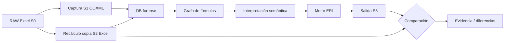

# ERI — Arquitectura y límites

**Estado:** diseño inicial, no implementación del motor.

El oráculo Excel nativo opera en Windows; extracción y modelado pueden operar en Windows o WSL2. No confundir `openpyxl` con evaluador de fórmulas. Las Skills transversales norman conducta, las internas todavía están por crear.
