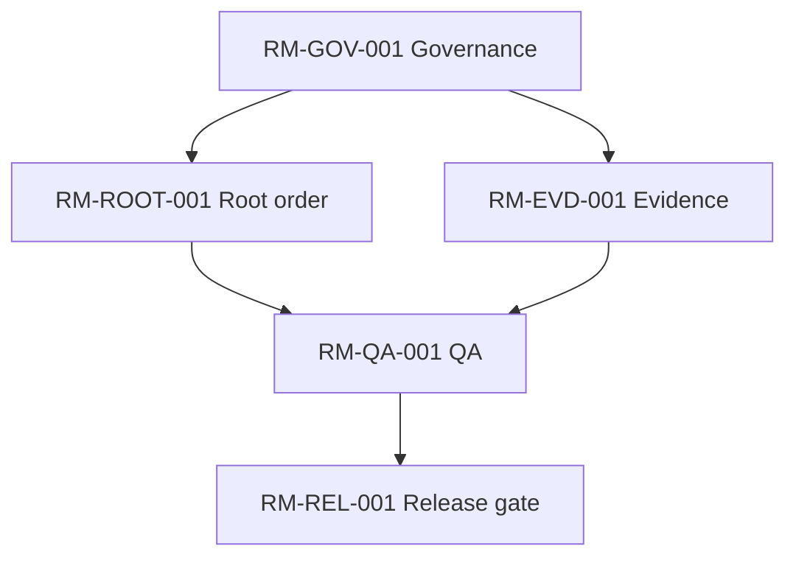
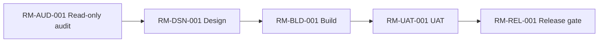
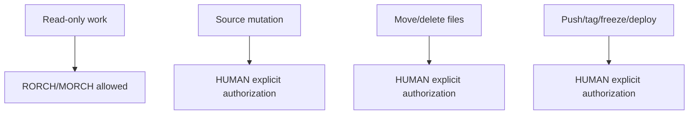
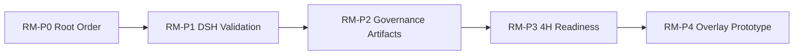
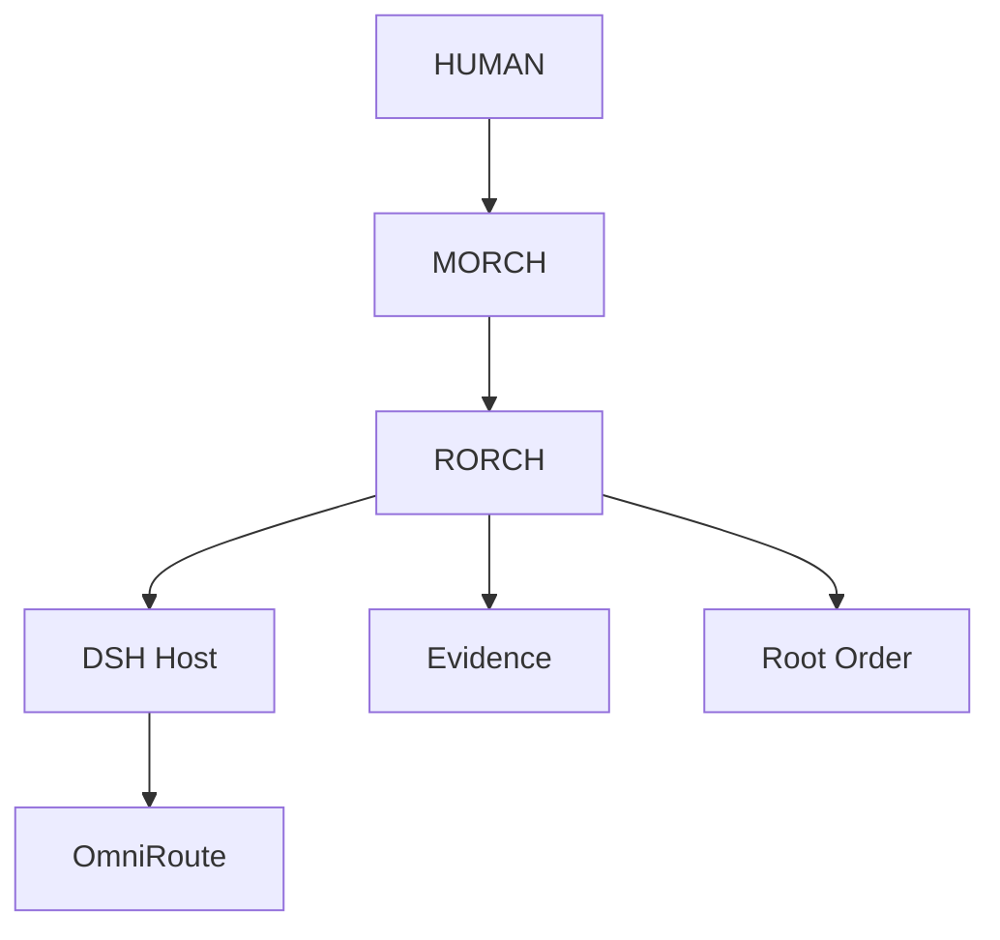
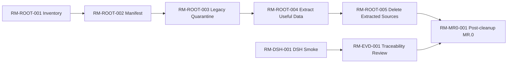
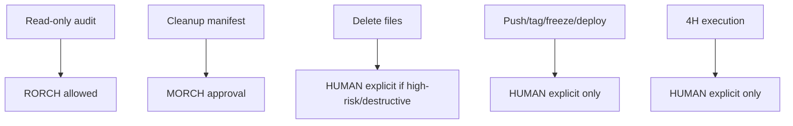
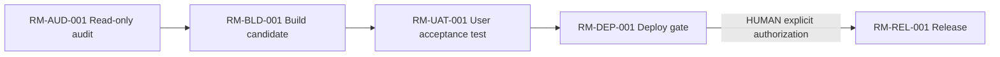

# ROADMAP.md — SKILL TRANSVERSAL CANÓNICA

**Estado:** CANDIDATA PARA REVISIÓN HUMAN; no instalada ni promovida al repositorio.  
**Versión propuesta:** 2026-10-17 / consolidación de tres fuentes, conservadas íntegramente en anexos.  
**Skill:** ROADMAP · **Clase:** TRANSVERSAL · **Aplicación:** proyectos y trabajo humano–IA, sin limitación sectorial.  
**Norma:** sus reglas medulares son obligatorias; la Skill interna del proyecto especializa sin debilitarlas.  
**Alcance de este archivo:** contrato, esquemas, mecanismos, ejemplos, validación, resoluciones y copias íntegras de fuentes.

## 0. Jerarquía, lectura e interpretación

0.1 **Jerarquía:** (a) instrucciones HUMAN vigentes y límites legales/de seguridad; (b) este contrato transversal; (c) Skill interna específica compatible; (d) Roadmap particular; (e) DAG, backlog y paquetes ejecutables. Una autorización no se deduce de una recomendación ni del texto de un plan. Las reglas de seguridad superiores prevalecen.

0.2 **MUST / DEBE:** obligación; **MUST NOT / NO DEBE:** prohibición; **SHOULD / DEBERÍA:** preferencia cuya desviación requiere razón documentada; **MAY / PUEDE:** opción. Una regla medular DEBE aplicarse o registrarse como bloqueo/no conformidad. El tamaño del proyecto ajusta el nivel de detalle, no elimina los invariantes.

0.3 **Precedencia dentro del archivo:** secciones 0–23 = contrato consolidado vigente; Anexos A–C = preservación literal y procedencia histórica, no mandatos paralelos. En discrepancia, aplicar la resolución explícita del registro de conflictos, nunca escoger tácitamente la variante más cómoda. Si surge conflicto no resuelto, escalar al HUMAN y dejar estado `OPEN_CONFLICT`, sin declarar aceptación final.

0.4 **Separación de responsabilidades:** esta Skill define cómo construir y evaluar Roadmaps. Una Skill interna (por ejemplo `SKILLS/Internal/NSH_ROADMAP.md`) define módulos, WBS, evidencias, vocabulario y gates particulares del proyecto. Este documento **NO** impone arquitecturas, productos, proveedores, nombres de carpetas, cinco P0 ni WBS NightShift a otros proyectos.

0.5 **Una verdad activa:** cada proyecto DEBE identificar exactamente un Roadmap activo por ámbito y versión. Puede guardar históricos y candidatos claramente rotulados. Actualización, promoción, control de cambios, Git y despliegues respetan autorizaciones efectivas.

## 1. Propósito y límites

ROADMAP es una representación estratégica, visual, trazable y ejecutable del camino desde el estado **demostrado** hasta resultados/capacidades objetivo. DEBE responder: adónde, por qué, para quién, dónde estamos, qué construir, qué entregar/mostrar, qué funciona, qué depende, qué es paralelo, qué bloquea, qué es opcional, qué requiere autorización, quién responde, cómo se comprueba y cuál es el siguiente DAG seguro.

NO sustituye backlog, MR.0 (revisión integrada del estado actual), HO.1 (traspaso de continuidad), runbook, registro de decisiones, manifiesto de limpieza, calendario ni lista de herramientas. Se vincula a ellos mediante referencias y contratos, sin reproducir procedimientos extensos en el cuerpo principal. Una tarea individual trivial usa miniplan proporcionado; un Roadmap formal mantiene invariantes, aunque pueda combinar representaciones.

**Regla PRODUCT_OR_OUTCOME_FIRST (obligatoria):** estructura el cuerpo principal por **capacidades del producto, resultados para beneficiarios, criterios de madurez y decisiones de desarrollo**. Gobernanza, actualización de documentación, Git y mantenimiento del propio Roadmap son habilitadores, nunca fin estratégico por defecto. Excepción legítima: cuando el producto solicitado sea precisamente documental, el documento puede ser un entregable central; justificarlo. No crear un Roadmap cuyo objetivo principal sea producir otro Roadmap sin necesidad del proyecto.

## 2. North Star y resultados observables

DEBE contener: North Star, usuarios/beneficiarios, problema, resultados deseados, alcance/no alcance, valor, indicadores cuantitativos o cualitativos verificables, estado actual y estado objetivo. Separar `OUTCOME` (efecto logrado), `CAPABILITY` (habilidad del sistema/proceso), `OUTPUT` (artefacto), `TASK` (acción), `EVIDENCE` (prueba) y `AUTHORIZATION` (permiso). Un output completado NO demuestra por sí mismo el outcome.

La estrategia DEBE justificar qué capacidades se construyen primero por su contribución a resultados, reducción de riesgo o desbloqueo de dependencias. No inventar ROI, fechas, duración, recursos ni promesas de desempeño.

## 3. Contrato de entregables visuales y funcionales (obligatorio)

Cada proyecto DEBE publicar un **catálogo de entregables inspectables**, desde lo elemental hasta lo avanzado, indicando tipo, versión, beneficiario, madurez esperada, evidencia y aceptación. Los niveles son escala de planificación **adaptable**, no siete entregables ficticios obligatorios:

| Nivel | Capacidad / entregable observable | Prueba de aceptación típica | Regla |
|---|---|---|---|
| L0 Conceptual | idea, requerimiento, diagrama, arquitectura, esquema, especificación | alcance y validación del concepto | solo define, NO funciona |
| L1 Visual | boceto, wireframe, maqueta, prototipo visual, dashboard, plano o informe inspectable | inspección por beneficiario, fidelidad identificada | visible NO implica funcional |
| L2 Funcional delimitado | prototipo con operación ejecutable de alcance acotado | demo y pruebas de funciones específicas | puede usar fixtures/mocks claramente marcados |
| L3 Integrado | interfaces/componentes conectados con contratos comprobados | pruebas E2E/integración y trazas | laboratorio NO implica producción |
| L4 Operacional controlado | funcionamiento repetible con fallos, recuperación y controles en ambiente definido | observabilidad, reinicio, replay/rollback pertinentes | alcance de ambiente explícito |
| L5 Productivo | resultado autorizado y comprobado en uso real | evidencia productiva, aprobación, métricas pertinentes | gate explícito; no inferir de L4 |
| L6 Evolutivo | mejora continua, ampliación y medición sostenida | métricas, experimentos y aceptación de iteraciones | evolución basada en evidencia |

Los proyectos no tecnológicos DEBEN traducir los niveles a entregables equivalentes, sin forzar software inexistente: un informe validado puede ser terminal si satisface el outcome. `NOT_APPLICABLE` exige motivo, no ausencia silenciosa. DEBE haber entregable inspeccionable temprano, salvo impedimento justificado. Cada etapa especifica **qué se verá**, **qué funcionará**, **qué todavía no funcionará**, aceptación, evidencia, propietario y dependencias. Diagramas del Roadmap y entregables visuales del producto son categorías distintas: ambos se definen donde correspondan.

## 4. Catálogo de módulos, fases y trazabilidad

Cada módulo, fase, workstream, gate, milestone, decisión y nodo de dependencia relevante DEBE tener ID estable, por defecto `RM-[DOMAIN]-[NNN]`; respetar convenciones preexistentes del proyecto. IDs canónicos y WBS son **identificadores semánticos**: prohibido reciclarlos o alterar significado; conservar deprecados en apéndice/registro. Todos los diagramas y filas de catálogos/tablas operativas muestran los IDs; los paquetes de tarea referencian módulo originario. No inventar IDs alternativos para renumerar historia.

**Contrato extensible de módulo (ningún campo original desaparece):**

```text
MODULE_ID=
MODULE_NAME=
TYPE=phase|workstream|gate|milestone|risk|dependency|decision
PURPOSE=
CAPABILITY_OR_OUTCOME=
USER_OR_BENEFICIARY=
OWNER=
STATUS=
CURRENT_MATURITY=
TARGET_MATURITY=
ENTRY_CRITERIA=
EXIT_CRITERIA=
DEPENDENCIES=
DEPENDENCY_TYPE=hard|soft|informational|gate
PARALLEL_ELIGIBILITY=
COMPLEXITY=
SPECIALIST_ROLE=
DELIVERABLES_VISUAL_FUNCTIONAL=
GATES=
EVIDENCE_REQUIRED=
EVIDENCE_LEVEL=
RISKS=
ROLLBACK_OR_RECOVERY=
NEXT=
NEXT_EXECUTABLE_NODE=
```

La ampliación no obliga a fingir datos: usar `UNKNOWN`, `NOT_APPLICABLE` o `PENDING_EVIDENCE` con razón. La fase DEBE conservar `PHASE_ID`, `PURPOSE`, `ENTRY_CRITERIA`, `EXIT_CRITERIA`, `WORKSTREAMS`, `DEPENDENCIES`, `GATES`, `EVIDENCE_REQUIRED`, `OWNER`, `RISKS`, `NEXT_PHASE`. No declarar cerrada ninguna fase sin evidencia de salida.

## 5. Estructura del Roadmap formal

El Roadmap producido por la Skill DEBE contener estas **18 secciones lógicas** (puede presentar subniveles y anexos sin omitir contenido):

1. North Star (resultados/beneficiarios); 2. Current State (verdad/evidencia); 3. Target State; 4. Strategy; 5. Module Catalog; 6. Diagrams (6.1 fase/progresión, 6.2 mapa de módulos/capacidades, 6.3 DAG dependencias, 6.4 mapa de gates); 7. Phases; 8. Milestones; 9. Dependencies; 10. Gates and Authorizations; 11. Risks and Assumptions; 12. Parallelization Plan / DAG; 13. Metrics and Evidence; 14. Review Cadence; 15. Change Rules; 16. Next Actions; 17. Decision Register; 18. Appendix / Deprecated IDs.

Además DEBE incorporar, ubicados pertinentemente dentro de esas secciones, el registro de entregables visuales/funcionales, el ranking de tareas complejas, la evaluación bots/agentes/SPECIALIST, la higiene de root y los criterios de convergencia. El **cuerpo** prioriza la evolución del proyecto/producto; detalles administrativos extensos se referencian o van a apéndices. No sacrificar contenido por una falsa brevedad.

## 6. Cuatro vistas gráficas obligatorias

Cada Roadmap formal DEBE disponer de: (i) progresión de fases o timeline, (ii) mapa de módulos/capacidades, (iii) DAG de dependencias, (iv) gates y autoridad. Mermaid es preferido en Markdown; ASCII/otras representaciones verificables se admiten cuando Mermaid no puede renderizarse. Para proyectos pequeños, una figura **puede** reunir cuatro vistas diferenciadas y comprobables; no se elimina ninguna. En proyectos complejos: vistas separadas para legibilidad.

Todos los nodos relevantes DEBEN mostrar ID de módulo, los bloqueos y trabajo paralelo ser visibles, las aristas coincidir con el catálogo y el gate permanecer explícito. No usar diagramas decorativos ni un flujograma secuencial artificial. La progresión NO requiere fechas: si no hay estimaciones autorizadas/evidenciadas, usar fases sin calendario. **PROHIBIDO inventar fechas, duraciones, capacidades, Gantt o deadlines.** Gantt fechado solo con solicitud HUMAN y estimaciones sustentadas. Los diagramas de ejemplo originales completos figuran en anexos históricos.

## 7. Método obligatorio GOALS → LOOPS → GRAPH/DAG → recursos → QA → cierre

1. **GOALS:** reconciliar North Star, alcance, impactos, resultados y múltiples objetivos sin visión de túnel.
2. **LOOPS:** ciclos iterativos con hipótesis, entradas, salidas, checkpoint, stop condition, criterios de reintento y aprendizaje.
3. **GRAPH/DAG:** descomponer tareas, dependencias reales, nodos habilitados, puertas de control, rutas alternativas y camino crítico. No introducir ciclos falsos; para iteración, modelar loops en metanivel y DAG por iteración/versión.
4. **AGENTS / SUBAGENTS / BOTS / SPECIALIST:** evaluar y asignar solo cuando aportan capacidad, costo-beneficio o independencia; no es requisito instanciar todos los tipos. Mantener una autoridad responsable y roles documentados.
5. **CROSS_CHECK:** revisión de resultados, impacto cruzado, independencia adecuada al riesgo y pruebas adversariales en elementos críticos.
6. **TERMINAL_CONVERGENCE:** cerrar únicamente tras satisfacer criterios y evidencias, con riesgos abiertos explícitos y gates respetados.

**NTV permanente:** `NO_TUNNEL_VISION=true`; `MAX_SAFE_PARALLELISM=true`; `NO_LOCAL_OPTIMIZATION=true`. Mantener frentes independientes activos cuando existan recursos y permisos; **serializar solo** por dependencia real, exclusión de recursos, integridad de evidencia, seguridad o gate. Registrar por qué se serializó. No confundir más agentes con más rendimiento.

## 8. Orden, limpieza y persistencia del root — obligación permanente

`ROOT_ORDER_AND_CLEANLINESS_PERMANENT=true`. Durante **todo** el ciclo, no solo al final, DEBE: (a) conocer root y fronteras; (b) inventariar/clasificar fuentes, temporales, evidencias, históricos, duplicados y desconocidos; (c) identificar origen de verdad único y registrar referencias externas; (d) prevenir proliferación de artefactos redundantes; (e) mantener nombres y estructura consistentes con Skill interna; (f) detectar deuda de orden; (g) preservar rastreabilidad, backups, provenance y evidencia; (h) comprobar residuos después de ejecutar; (i) preparar una limpieza controlada con impacto, allowlist y rollback.

**NO** equivale a autorización de borrar, mover, limpiar credenciales, reescribir historia, desactivar logs ni destruir fuentes. Acciones destructivas o irreversibles respetan gates del HUMAN y políticas de retención; si cerrados, registrar la deuda sin ocultarla. Cada aceptación de ciclo DEBE especificar `ROOT_HYGIENE_STATUS`, `NEW_ARTIFACTS`, `DUPLICATES`, `UNCLASSIFIED`, `CLEANUP_PROPOSALS` y `AUTHORIZED_EFFECTS`. Un bloqueo de limpieza no impide seguir frentes independientes; sí impide declarar root limpio.

## 9. Complejidad y routing de SPECIALIST — registro obligatorio

Cada Roadmap DEBE tener **registro completo de tareas complejas**, clasificado y **ordenado de mayor a menor dificultad**; si no existen, `NONE_VERIFIED` con criterio. También DEBE evaluar la conveniencia de agentes, subagentes y bots. La recomendación de SPECIALIST es opcional; la **evaluación y justificación** es obligatoria.

| Nivel | Dificultad | Ruta recomendada |
|---|---|---|
| D5 | Crítica / incertidumbre y riesgo altos | SPECIALIST y contraste independiente recomendados; aprobación según riesgo/costo |
| D4 | Muy compleja | Evaluar y recomendar SPECIALIST, subdivisión y prueba adversarial |
| D3 | Compleja | Comparar RORCH/ejecutor con SPECIALIST o bot especializado |
| D2 | Moderada | Ejecutor habitual, QA proporcional |
| D1 | Rutinaria | Ejecución controlada sin overhead artificial |

**Ranking:** dificultad técnica, incertidumbre, irreversibilidad, impacto/cross-dependencies, requisitos de acceso/seguridad, dificultad de verificación; no igualar complejidad con tiempo estimado. El registro DEBE incluir `TASK_ID`, `MODULE_ID`, `LEVEL`, `RATIONALE`, `EXPECTED_RESULT`, `OWNER`, `PROPOSED_SPECIALIST_OR_BOT`, `ALTERNATIVE`, `DEPENDENCIES`, `EVIDENCE`, `GATE`, `PARALLEL_ELIGIBILITY`. Ninguna asignación supone habilitación para gasto, datos privados, credenciales o deployment.

## 10. Bots, agentes y límites de autoridad

Los bots de terceros o locales —ejemplos ilustrativos: Grok Bots, dsh-bots— son **tipos potenciales de recurso**, no componentes asumidos como instalados ni verificados. La Skill interna o el registro de capacidades debe demostrar disponibilidad antes de proponer invocación. Un bot no asciende por su nombre a autoridad HUMAN/MORCH. La organización particular del proyecto define roles; esta Skill exige que los permisos nunca excedan los autorizados.

Contrato mínimo de cada recurso: `RESOURCE_ID`, `TYPE`, `PROVIDER_OR_RUNTIME`, `CAPABILITY`, `OBSERVED_AVAILABILITY`, `INPUT_OUTPUT_SCHEMA`, `AUTHORIZED_SCOPE`, `TRUST_BOUNDARY`, `TIMEOUT`, `RETRY_POLICY`, `IDEMPOTENCY`, `COST_LIMIT`, `TRACE_CORRELATION`, `EVIDENCE_PROVENANCE`, `FAILURE_AND_ROLLBACK`, `ESCALATION_OWNER`. Evaluar bots/agents/SPECIALIST en DAG; evitar tareas duplicadas y human relay innecesario. Protocolos MCP, A2A, colas u otros son **opciones de integración**, no interfaces presumidas.

## 11. Modelo de evidencia y madurez

Un estado DEBE indicar fuente, fecha/versión, ambiente, método y nivel de garantía:

- `OBSERVED_AND_VERIFIED`: observado y comprobado directamente bajo alcance declarado.
- `REPORTED_ONLY`: afirmado por otro actor, sin corroboración independiente.
- `INFERRED`: interpretación; identificar razonamiento/limitación.
- `ASSUMED`: hipótesis explícita a comprobar.
- `PENDING_EVIDENCE` o `UNKNOWN`: insuficiente evidencia.

Progresión de pruebas, **no equivalencias automáticas**: especificación/revisión → simulación/mock → laboratorio fixture → integración de componentes → prueba operacional controlada → producción autorizada. Se puede saltar un escalón con evidencia apropiada; nunca declarar `PRODUCTIVE_PASS` por PASS_LAB. Cada aceptación DEBE mostrar pruebas positivas/negativas pertinentes, casos no ejecutados/fallidos, hashes/inputs cuando procedan, riesgos residuales y capacidades no demostradas. Evidencia externa y repo no implican verdad de runtime.

## 12. Dependencias, prioridad y ejecución multipath

Clasificar dependencias: técnicas duras, gates de autorización, exclusiones de recursos, informativas y preferencias. Solo las primeras tres pueden justificar bloqueo/serialización sin análisis adicional; preferencias nunca se disfrazan de requisitos. Cada nodo indica `READY|BLOCKED|RUNNING|DONE_VERIFIED|PARTIAL|UNKNOWN`, owner, entrada/salida, criterio de aceptación, impacto y próximo nodo. Contrastar valor al beneficiario, criticidad, riesgo, costo y capacidad **sin inventar cifras**. Exponer rutas alternativas y trabajo independiente listo ahora.

Un DAG temporal de ejecución es derivado del Roadmap; una lista de tareas sin conexiones no lo sustituye. Las decisiones sobre acceso, pagos, fuentes productivas, limpieza destructiva y publicación requieren gates explícitos. Si autorización falta, preparar trabajos seguros independientes, no simular efecto.

## 13. Riesgos, opciones, seguridad y gestión de cambios

Separar **opción** frente a **camino comprometido**; incluir riesgos, supuestos, triggers y mitigación. Revisar impacto en áreas adyacentes antes de mutar un módulo. Preservar rollback/roll-forward donde corresponda. `DECISION_ID` estable, estado propuesto/aprobado/rechazado/deferido, autoridad y evidencia; no convertir aspiración en autorización.

Registrar cambios de Roadmap mediante diff semántico: alta/baja de capacidades, dependencias, outcomes, clasificación de riesgo, prioridades, gates, evidencia y consecuencias. Ningún cambio editorial puede reescribir resultados o decisiones anteriores silenciosamente. Versionar y mantener un único activo. No confundir `Git clean` con producto completo.

## 14. Métricas, revisión y aceptación

Medir resultados propios del proyecto, no métricas genéricas sin relación. Ejemplos condicionales: adopción, tiempo de recuperación, error rate, cobertura de pruebas, satisfacción de usuario, despliegue seguro o métricas DORA para software cuando corresponda; **no exigir software KPIs a proyectos jurídicos/inmobiliarios**. DEBE registrar línea base disponible o `UNKNOWN`, target sustentado, método de captura, owner y evidencia. Revisión por evento de cambio material y cadencia acordada según complejidad; no inventar reuniones o fechas.

**Acceptance gate:** todos los controles medulares deben aprobarse o figurar con bloqueo explícito; un Roadmap incompleto retorna `REJECTED_AS_INCOMPLETE_ROADMAP`. Los resultados de ejecución no pueden elevarse de laboratorio a producción por presentarlos dentro de un Roadmap.

## 15. Quality Gate estructural y semántico — obligatorio

**Estructural:** versión/fecha; un solo Roadmap activo; North Star/actual/objetivo/estrategia; 18 secciones; catálogo y IDs; 4 vistas gráficas; fases con entrada/salida; entregables visuales/funcionales; ranking de tareas complejas; registro recursos/bots; NTV, root hygiene; riesgos/supuestos; milestones; gates; métricas/evidencia; review/change rules; do-not-do; next DAG; decisiones/apéndice/deprecados; vínculo a Skill interna y roles.

**Semántico:** (a) capacidades explican valor al beneficiario; (b) aristas de diagramas coinciden con dependencias reales; (c) estados no exceden evidencias; (d) no hay bloqueo falso de trabajo paralelo; (e) no hay ciclos en DAG de instancia; (f) gates corresponden al permiso efectivo; (g) priorización coherente con riesgo/resultado; (h) contratos de entregables muestran qué es inspeccionable y funcional; (i) el Roadmap no se centra en administrarse; (j) limpieza preserva fuentes y autorizaciones; (k) bots/SPECIALIST no tienen capacidades inventadas; (l) origen de verdad único y trazable.

Aplicar revisión adversarial proporcional: candidato → autocritica → versión corregida → revisión de riesgo → evidencia → decisión; independencia adicional para D4/D5 o alto impacto. El validador automático DEBE comprobar estructura referencial posible; la revisión de significado no se sustituye por conteos. Ante evidencia conflictiva, registrar `FAIL/PARTIAL/OPEN_CONFLICT`, no declarar `PASS` vacío.

## 16. Modos de fallo prohibidos

Rechazar Roadmap como: wish list; calendario sin dependencias; estado sin evidencia; gates ocultos; todo igual de prioritario; ausencia de `not ready`; falta de revisión; backlog disfrazado; prosa sin diagramas; diagramas sin IDs; divergencia gráfica/catálogo; omisión de workstream solicitado; stub administrativo; múltiples verdades activas; falso progreso por hashes/archivos; `PASS_LAB` presentado como productivo; ruta crítica artificial; bot con capacidades presumidas; root sucio ocultado; entregables visuales sin contrato funcional; roadmap que solo describe la creación del roadmap.

## 17. Ejecución mínima y reporte

Salida machine-oriented posible (complementa, no reemplaza el Roadmap humano):

```text
TARGET=ROADMAP
PROJECT=
NORTH_STAR=
CURRENT_STATE=
TARGET_STATE=
STRATEGY=
MODULE_CATALOG=
DELIVERABLE_PROGRESSION=
COMPLEXITY_REGISTER_DESC=
AGENT_BOT_SPECIALIST_ROUTING=
DIAGRAMS=FOUR_VIEWS_VALIDATED
PHASES=
MILESTONES=
DEPENDENCIES=
PARALLEL_DAG=
GATES=
RISKS=
ASSUMPTIONS=
ROOT_HYGIENE_STATUS=
NEXT_DAG=
METRICS=
EVIDENCE_LEVEL=
REVIEW_CADENCE=
CHANGE_RULES=
NEXT_ACTIONS=
OPEN_CONFLICTS=
```

**Contrato de tarea derivada:** `TASK_ID`, `MODULE_ID`, `GOAL`, `INPUTS`, `DEPENDENCIES`, `OWNER`, `RESOURCES`, `GATES`, `ALLOWED_EFFECTS`, `DENIED_EFFECTS`, `TESTS`, `ACCEPTANCE`, `EVIDENCE_OUTPUT`, `ROLLBACK`, `NEXT`. Compactación de mensajes y DELTA_ONLY no permite sacrificar verdad, evidencias materiales ni decisiones.

## 18. Excepciones y proporcionalidad

Obligatorio lo medular; adaptable la presentación. Un mini-proyecto puede combinar diagramas y tener niveles de entrega `NOT_APPLICABLE`, pero DEBE comunicar el porqué. Debe existir clasificación de complejidad (aunque `NONE_VERIFIED`), higiene de archivos aplicable (si no hay repo, control sobre ubicación documental), y evidencia/autoridades. Una excepción a contenido normativo requiere `RULE_ID`, `PROJECT`, `JUSTIFICATION`, `IMPACT`, `ALTERNATIVE_CONTROL`, `AUTHORITY`, `APPROVAL_EVIDENCE`, `EXPIRY_OR_REVIEW`; jamás se obtiene por silencio.

## 19. Ejemplo transversal de aplicación: contraste entre actividades y capacidad

- **Incorrecto como North Star:** “redactar el Roadmap, crear MR0 y terminar el índice”. Son actividades de gestión, no necesariamente resultados del proyecto.
- **Correcto para producto de automatización (solo ilustrativo):** “el usuario solicita un objetivo, el sistema lo ejecuta y puede reanudarlo tras fallos, con pruebas y control de permisos”. Los documentos apoyan su trazabilidad.
- **Correcto para informe inmobiliario (solo ilustrativo):** “el comité puede decidir una operación con análisis y evidencia verificables”; el documento final validado es entregable central, no anomalía.

## 20. Plantilla mínima de registro de complejidad, entregables y root

| ID | Módulo | Capacidad/resultado | Nivel de entrega | Demostración visual | Demostración funcional | Complejidad D5→D1 | Bot/SPECIALIST evaluado | Gate | Evidencia |
|---|---|---|---|---|---|---|---|---|---|
| RM-EX-001 | RM-EX-001 | Ejemplo: experiencia inspectable | L1 | maqueta revisada | N/A justificado | D2 | no aporta | revisión humana | acta |
| RM-EX-002 | RM-EX-002 | Ejemplo: operación integrada | L3 | diagrama y pantalla | prueba E2E acotada | D4 | SPECIALIST sugerido, no autorizado | gate de integración | trace |

**Higiene:** `{root_or_workspace, canonical_paths, inventory_scope, unclassified, duplicate_candidates, temporary_artifacts, preservation_policy, cleanup_gate, rollback_plan, post_run_delta}`. No borrar automáticamente lo listado.

## 21. Registro de conflictos y conciliación de fuentes

| ID | Divergencia original | Decisión normativa | Material preservado |
|---|---|---|---|
| C01 | S2 permite un diagrama combinado en proyectos pequeños; S1/S3 exigen 4 vistas | Cuatro vistas siempre; figura combinada solo si identificables y validadas | S1/S2/S3 íntegros |
| C02 | S2 tiene 16 secciones; S1/S3 añaden Decision Register y Appendix | 18 secciones lógicas; preservar teoría y definiciones S2 | S1/S2/S3 |
| C03 | Ejemplos secuenciales pueden inducir dependencia falsa | Ejemplos ilustrativos, no DAG exigido; NTV exige revisar paralelismo | S2 ejemplos y S1/S3 diagramas |
| C04 | Ejemplos de borrado y aprobaciones con diferencias de alcance | Control de riesgo: cambios destructivos sujetos a autoridad efectiva y política del proyecto; no conceder autorización implícita | ejemplos históricos completos |
| C05 | Grafías `Skiils`, `Skills2`, `ROADMAP(1)` | nombre canónico `ROADMAP.md`; nombres originales mantienen trazabilidad histórica | nombres y textos anexados |
| C06 | S2 usa ejemplos NightShift/DSH en Skill transversal | ejemplos conservados, sin convertir productos/herramientas en requisitos transversales | S2 íntegro |
| C07 | Catálogo enfatiza trabajo/output | exigir capacidad, outcome y entregable visual/funcional verificables | esquema original retenido y extendido |
| C08 | S1 mejora fechas e IDs sobre S3 | prohibición de calendario inventado y estabilidad semántica reforzadas | S1 y S3 íntegros |

No se identificó evidencia de que las tres fuentes autoricen cambiar producción, usar bots específicos o declarar capacidades productivas a partir de laboratorio. Esas capacidades requieren pruebas/autoridad externa al texto original. Si se detecta nuevo conflicto al adoptar la Skill, añadir entrada C09+ sin ocultarlo.

## 22. Matriz de cobertura y procedencia (no pérdida)

**Método:** se conservan las tres fuentes **literalmente completas** en los Anexos A–C. Por ello ninguna sección, ejemplo, excepción, tabla o plantilla original se elimina del artefacto consolidado. La siguiente matriz indica su destino normativo; la conservación literal no significa tres autoridades concurrentes.

| Familia del contenido fuente | S1 (`ROADMAP(1)`) | S2 (`ROADMAP_Skills(1)`) | S3 (`ROADMAP_Skills2`) | Contrato consolidado |
|---|---|---|---|---|
| Identidad, definiciones, cuándo usar y no usar | §0 | §0, §§3–7 | §0 | §§0–2, 18 |
| Diagramas, cuatro vistas, templates, calidad | §§1,5 | §§1,11–12 | §§1,5 | §§5–6,15; Anexos |
| IDs estables, módulo y fase | §§2,4 | §§2,9–10 | §§2,4 | §4; C08 |
| Estructura secciones | §3 | §8 | §3 | §5; C02 |
| Gates, riesgos, evidencia | §§6,8 | §§13–15 | §§6,8 | §§11–15 |
| Anti-stub, QA, aceptación | §§6–9 | §§15,17–19 | §§6–9 | §§14–16 |
| DAG, paralelismo, output IA | §§0,6 | §§13–14 | §§0,6 | §§7,12,17 |
| Refinamiento del razonamiento | implícito QA | §16 | implícito QA | §15 |
| Reglas únicas: fechas e identidad de WBS | §§1–2 | no idénticas | no presentes en S3 | §§4,6; C08 |
| Entregables, complejidad, root, bots, outcome | añadidos acordados 2026-10-17 | añadidos acordados | añadidos acordados | §§2–3,7–10,15,20 |

**Revisión de no pérdida de obligaciones:** cada sección original está copiada íntegra; el validador final verifica igualdad byte-a-byte del texto fuente incorporado (con separadores externos) y reporta SHA-256 de cada fichero fuente. Las reglas históricas incongruentes quedan preservadas, pero C01–C08 y la precedencia §0.3 fijan la lectura operativa.

## 23. Lista de aceptación del archivo consolidado y del Roadmap que produce

**Skill consolidada:** verificar las tres fuentes embebidas íntegras, SHAs, resoluciones C01–C08, términos MUST, claridad transversal/interna, inclusión de entregables, ranking, bots, NTV+root, tests y ejemplos; no afirmar que ha sido adoptada en un repo si es candidata.

**Roadmap del proyecto:** `[ ]` versión; `[ ]` único activo; `[ ]` beneficiario/outcome; `[ ]` estado real/objetivo/estrategia; `[ ]` catálogo y IDs; `[ ]` 18 secciones; `[ ]` cuatro vistas con IDs; `[ ]` entradas/salidas de fases; `[ ]` entregables visuales y funcionales, progresión adecuada; `[ ]` complejidad ordenada; `[ ]` evaluación bots/SPECIALIST; `[ ]` NTV y DAG paralelo; `[ ]` root hygiene; `[ ]` riesgos; `[ ]` evidencia/madurez; `[ ]` gates/autorización; `[ ]` métricas; `[ ]` no hacer; `[ ]` revisión/cambios; `[ ]` decision register; `[ ]` apéndice; `[ ]` siguiente DAG accionable; `[ ]` revisión semántica y auditoría cuando corresponda. **Fallar un MUST = no emitir `FINAL_PASS`.**

---

# ANEXOS DE CONSERVACIÓN LITERAL — HISTÓRICOS, NO AUTORIDAD PARALELA

Los anexos reproducen **cada uno de los tres archivos originales completos**. No se corrige la ortografía interna (`Skiils`), no se recortan ejemplos ni se reescriben cláusulas. Su función es permitir revisión humana y reconstrucción de decisiones. La norma efectiva es §§0–23 y el registro C01–C08. No interpretar ejemplos históricos como autorización de ejecución.

---

## ANEXO A — S1: `ROADMAP(1).md` (SHA-256 original `fd7175fed7b856c0bf0fde4f81389491b160ee5ee1fe09bb4220c6828e6d22b9`; 6942 bytes)

<!-- BEGIN_LITERAL_SOURCE_S1 -->
# ROADMAP.md — Transversal Roadmap Skill

**Skill name:** ROADMAP  
**Scope:** Transversal.  
**Purpose:** Produce dependency-aware, visually inspectable roadmaps with phases, modules, gates, milestones, risks, evidence and next DAG.

---

## 0. Definition

A roadmap is not a task list, backlog, calendar, MR.0, HO.1 or runbook.

A roadmap explains:

```text
Where are we going?
Where are we now?
What must happen first?
What can happen in parallel?
What is blocked?
What is optional?
What requires approval?
How do modules connect?
Which module owns each workstream?
What is the next executable DAG?
```

Terminal rule:

```text
If the roadmap does not visually show what can safely happen next, what depends on what, which module owns the work, and what must not happen yet, it is not a roadmap; it is narrative.
```

---

## 1. Mandatory diagrams

A roadmap without diagrams is incomplete.

Every formal roadmap must include:

```text
1. Phase / timeline diagram
2. Module map
3. Dependency DAG
4. Gate / authorization map
```

For Markdown, Mermaid is preferred.

The phase / timeline requirement may be satisfied by a non-dated phase,
progression, or sequencing diagram when dates are not authorized or not
evidence-grounded. Do not invent deadlines, durations, capacity estimates, or
Gantt schedules. Use a Gantt/calendar view only when HUMAN explicitly requests
one and the estimates are sourced.

---

## 2. Mandatory IDs

Every module, phase, workstream, gate, milestone, decision and relevant dependency node must have a stable ID.

Default format:

```text
RM-[DOMAIN]-[NNN]
```

Rules:

```text
- IDs must be stable across versions.
- IDs must not be reused for another module.
- Deprecated IDs remain in the appendix or decision register.
- Every diagram must show IDs.
- Every table row must include IDs.
- Every task generated from the roadmap must reference the originating module ID.
- Canonical IDs and WBS IDs are semantic identifiers. Do not reuse or redefine
  an existing ID for a different deliverable; create a new stable ID for new
  controls or expanded work.
```

---

## 3. Required sections

```markdown
# ROADMAP

## 1. North Star
## 2. Current State
## 3. Target State
## 4. Strategy
## 5. Module Catalog
## 6. Diagrams
   6.1 Phase / Timeline Diagram
   6.2 Module Map
   6.3 Dependency DAG
   6.4 Gate / Authorization Map
## 7. Phases
## 8. Milestones
## 9. Dependencies
## 10. Gates and Authorizations
## 11. Risks and Assumptions
## 12. Parallelization Plan / DAG
## 13. Metrics and Evidence
## 14. Review Cadence
## 15. Change Rules
## 16. Next Actions
## 17. Decision Register
## 18. Appendix / Deprecated IDs
```

---

## 4. Module catalog schema

Every module must appear in the catalog before being used in diagrams or WBS.

```text
MODULE_ID=
MODULE_NAME=
TYPE=phase|workstream|gate|milestone|risk|dependency|decision
PURPOSE=
OWNER=
STATUS=
ENTRY_CRITERIA=
EXIT_CRITERIA=
DEPENDENCIES=
GATES=
EVIDENCE_REQUIRED=
RISKS=
NEXT=
```

Minimum table:

| Module ID | Name | Type | Status | Purpose | Exit evidence |
|---|---|---|---|---|---|
| RM-ROOT-001 | Root inventory | Workstream | Pending | Refresh file/folder inventory | Inventory JSON |
| RM-EVD-001 | Evidence model | Workstream | Pending | Define evidence | Evidence schema |
| RM-GATE-001 | Authorization gate | Gate | Pending | Prevent premature mutation | Explicit authorization |

---

## 5. Diagram templates

### 5.1 Phase / timeline


### 5.2 Module map



### 5.3 Dependency DAG



### 5.4 Gate map



---

## 6. Quality gates

A roadmap is acceptable only if:

```text
- current state is explicit;
- target state is clear;
- every module has a stable ID;
- diagrams are included and show IDs;
- dependencies are visible;
- gates and authorizations are explicit;
- blocked paths are visible;
- parallel work is shown;
- risks and assumptions are preserved;
- metrics/evidence exist;
- next DAG is actionable;
- review/update rules exist;
- uncertainty is not hidden;
- recommendation is separated from authorization;
- roadmap is distinguished from backlog, MR.0 and HO.1.
```

---

## 7. Anti-stub rule

Reject any roadmap that is only:

```text
- status rows;
- “synced” claims;
- headers;
- short current-state summary;
- task list without dependencies;
- calendar without gates;
- backlog without strategy;
- prose without diagrams;
- diagrams without module IDs;
- no next executable DAG.
```

Use:

```text
STATUS=REJECTED_AS_INCOMPLETE_ROADMAP
```

---

## 8. Acceptance checklist

```text
[ ] Version/timestamp exists.
[ ] One active roadmap is identified.
[ ] North Star exists.
[ ] Current State exists.
[ ] Target State exists.
[ ] Strategy exists.
[ ] Module Catalog exists.
[ ] All modules have IDs.
[ ] All WBS/task rows have IDs.
[ ] Phase / Timeline diagram exists.
[ ] Module Map exists.
[ ] Dependency DAG exists.
[ ] Gate / Authorization Map exists.
[ ] WBS or execution structure exists.
[ ] Specialist/complex tasks are identified when applicable.
[ ] Priorities exist.
[ ] Cleanup/order module exists when cleanup is in scope.
[ ] Gates/authorizations are explicit.
[ ] Do-not-do list exists.
[ ] Next DAG exists.
[ ] Roadmap vs backlog vs MR.0 vs HO.1 is distinguished.
```

If a required checkbox fails, do not deliver as final.

---

## 9. Failure modes to avoid

```text
FAIL-001 Roadmap as wish list.
FAIL-002 Roadmap as calendar without dependencies.
FAIL-003 Roadmap ignoring current evidence.
FAIL-004 Roadmap hiding authorization gates.
FAIL-005 Roadmap treating all tasks as equal.
FAIL-006 Roadmap unable to say “not ready.”
FAIL-007 Roadmap without review cadence.
FAIL-008 Roadmap confusing backlog with strategy.
FAIL-009 Roadmap without diagrams.
FAIL-010 Roadmap without module IDs.
FAIL-011 Diagrams that do not match module catalog.
FAIL-012 Roadmap omitting a major known user-requested workstream.
FAIL-013 Roadmap accepting a stub as complete.
FAIL-014 Roadmap creating parallel sources of truth.
```
<!-- END_LITERAL_SOURCE_S1 -->

---

## ANEXO B — S2: `ROADMAP_Skills(1).md` (SHA-256 original `d9a159399b810fe8548b029201607bbee52e7194f0bd9eb9bfe23397c3db3c49`; 11897 bytes)

<!-- BEGIN_LITERAL_SOURCE_S2 -->
# ROADMAP_Skiils.md — Roadmap Skill

> Naming note: file name preserves the requested spelling `Skiils`.

## 0. Skill identity

**Skill name:** ROADMAP  
**Category:** Strategy / sequencing / dependency management / visual planning  
**Scope:** Transversal; not specific to NightShift, software or AI.  
**Primary users:** Humans, AI systems, product managers, project managers, technical leads, legal/finance/operations teams.  
**Core output:** A dependency-aware and visually inspectable path from current state to target state, with phases, modules, gates, milestones, risks, diagrams and next DAG.

---

## 1. Mandatory rule: roadmaps must include diagrams

A roadmap without diagrams is incomplete.

Every formal ROADMAP deliverable must include at least:

```text
1. Phase / timeline diagram
2. Module map
3. Dependency DAG
4. Gate / authorization map
```

For small projects, one combined diagram is acceptable. For complex projects, use multiple diagrams.

The purpose is not decoration. Diagrams are required because humans and AI systems need to see:

```text
- sequencing;
- parallel work;
- dependencies;
- gates;
- blocked paths;
- module boundaries;
- authority boundaries;
- where execution may safely continue.
```

If diagrams cannot be rendered graphically, include Mermaid diagrams or ASCII diagrams. Mermaid is preferred for Markdown.

---

## 2. Mandatory rule: every module must have an ID

Every roadmap module, phase, workstream, gate and relevant dependency node must have a stable code.

Use this structure unless the project already has a better convention:

```text
RM-[DOMAIN]-[NNN]
```

Examples:

```text
RM-GOV-001   Governance baseline
RM-ROOT-001  Root inventory
RM-ROOT-002  Cleanup manifest
RM-DSH-001   DSH read-only smoke
RM-EVD-001   Evidence model
RM-4H-001    4H readiness review
RM-UX-001    Overlay product scope gate
```

Rules:

1. IDs must be stable across roadmap versions.
2. IDs must not be reused for a different module.
3. Deprecated IDs must remain in the decision register or appendix.
4. Every diagram must show module IDs, not only names.
5. Every table row must include module ID.
6. Every task packet generated from the roadmap must reference the originating module ID.

---

## 3. Plain-language definition for humans

A ROADMAP explains:

```text
Where are we going?
Why are we going there?
Where are we now?
What must happen first?
What can happen in parallel?
What is blocked?
What is optional?
What requires approval?
What would change the plan?
How do the modules connect?
Which module ID owns each workstream?
```

A roadmap is not a task list and not a calendar. It is a structured, visual and dependency-aware path from current truth to target state.

---

## 4. Technical definition for AI systems

For an AI system, a ROADMAP is a planning and governance artifact:

```text
north_star
+ current_state
+ target_state
+ module_catalog
+ phases
+ dependencies
+ gates
+ risks
+ diagrams
+ DAG
+ update_rules
```

The AI must distinguish:

- goal vs task;
- phase vs milestone;
- dependency vs preference;
- recommendation vs authorization;
- committed path vs option;
- critical path vs parallel work;
- roadmap vs backlog;
- module ID vs descriptive title;
- diagrammed dependency vs narrative sequence.

---

## 5. When to use a ROADMAP

Use a roadmap when:

1. The work spans multiple phases.
2. There are dependencies or gates.
3. Many tasks compete for attention.
4. The project can drift without a north star.
5. Stakeholders need common direction.
6. AI/human sessions must remain aligned over time.
7. There are parallel tracks and long-term decisions.
8. Work must be visually inspected before execution.
9. Modules require stable IDs for traceability.

Examples:

- Product launch roadmap.
- Real estate closing roadmap.
- Bank financing package roadmap.
- Academic capstone/project roadmap.
- AI autonomy readiness roadmap.
- Technical migration roadmap.
- Legal negotiation roadmap.
- Root cleanup and legacy extraction roadmap.
- DSH / runtime integration roadmap.

---

## 6. When not to use a full ROADMAP

Do not overbuild a full roadmap for a one-off task. Use a checklist or mini-plan instead.

A mini-plan still needs IDs if it creates durable work modules.

---

## 7. Roadmap vs related artifacts

| Artifact | Purpose | Time horizon | Typical output |
|---|---|---:|---|
| ROADMAP | Direction, modules, phases, dependencies, gates and diagrams | Medium/long | Visual phased plan and DAG |
| Backlog | Inventory of possible work | Variable | Prioritized or categorized list |
| MR.0 | Integrated current-state review | Now / decision point | Truth, risk, next nodes |
| HO.1 | Session/person handoff | Immediate continuity | Compact state transfer |
| Decision Register | Record of decisions | Historical/current | Accepted/deferred/rejected decisions |
| Runbook | Operational procedure | Repeated execution | Step-by-step actions |
| Cleanup Manifest | Classification of files/resources | Operational | Keep/move/extract/delete plan |

---

## 8. Required roadmap sections

```markdown
# ROADMAP

## 1. North Star
## 2. Current State
## 3. Target State
## 4. Strategy
## 5. Module Catalog
## 6. Diagrams
   6.1 Phase / Timeline Diagram
   6.2 Module Map
   6.3 Dependency DAG
   6.4 Gate / Authorization Map
## 7. Phases
## 8. Milestones
## 9. Dependencies
## 10. Gates and Authorizations
## 11. Risks and Assumptions
## 12. Parallelization Plan / DAG
## 13. Metrics and Evidence
## 14. Review Cadence
## 15. Change Rules
## 16. Next Actions
```

A roadmap missing module IDs or diagrams is incomplete.

---

## 9. Module catalog model

Every module must appear in a catalog before being used in a diagram.

```text
MODULE_ID=
MODULE_NAME=
TYPE=phase|workstream|gate|milestone|risk|dependency|decision
PURPOSE=
OWNER=
STATUS=
ENTRY_CRITERIA=
EXIT_CRITERIA=
DEPENDENCIES=
GATES=
EVIDENCE_REQUIRED=
RISKS=
NEXT=
```

Example:

| Module ID | Name | Type | Status | Purpose | Exit evidence |
|---|---|---|---|---|---|
| RM-ROOT-001 | Root inventory | Workstream | Pending | Refresh file/folder inventory | Inventory JSON |
| RM-ROOT-002 | Cleanup manifest | Workstream | Pending | Classify keep/move/extract/delete | Cleanup manifest |
| RM-DSH-001 | DSH smoke | Workstream | Pending | Validate DSH→OmniRoute→repo | Smoke report |
| RM-4H-001 | 4H readiness review | Gate | Closed | Define readiness without execution | Readiness matrix |

---

## 10. Phase model

A phase should have:

```text
PHASE_ID=
PURPOSE=
ENTRY_CRITERIA=
EXIT_CRITERIA=
WORKSTREAMS=
DEPENDENCIES=
GATES=
EVIDENCE_REQUIRED=
OWNER=
RISKS=
NEXT_PHASE=
```

Do not declare a phase complete without exit evidence.

---

## 11. Required diagrams

### 11.1 Phase / Timeline Diagram

Purpose: show progression across phases.

Preferred Mermaid:



### 11.2 Module Map

Purpose: show major modules and their relationships.



### 11.3 Dependency DAG

Purpose: show what depends on what.



### 11.4 Gate / Authorization Map

Purpose: show authority required.



---

## 12. Diagram quality rules

Diagrams must:

1. Include module IDs.
2. Show gates explicitly.
3. Show blocked nodes explicitly.
4. Show parallel work where relevant.
5. Avoid decorative complexity.
6. Match the module catalog.
7. Be updated when the roadmap changes materially.
8. Use industry terms where available and internal terms only where necessary.

Bad diagram:

```text
Audit -> Build -> Deploy
```

Good diagram:



---

## 13. DAG model

A good roadmap includes a DAG or equivalent dependency graph:

```text
Node A: Read-only audit
Node B: Design spec
Node C: Implementation
Node D: Validation
Node E: Readiness review
Node F: Execution gate

A -> B -> C -> D -> E -> F
D can run in parallel with documentation if no shared mutation exists.
```

Rules:

- Parallelize independent work.
- Serialize only real dependencies, safety gates or technical constraints.
- Do not hide blocked nodes.
- Do not put speculative work on the critical path unless labelled.
- Do not create a roadmap with only prose when a dependency graph is needed.

---

## 14. Roadmap output schema for AI

```text
TARGET=ROADMAP
PROJECT=
NORTH_STAR=
CURRENT_STATE=
TARGET_STATE=
STRATEGY=
MODULE_CATALOG=
DIAGRAMS=
PHASES=
MILESTONES=
DEPENDENCIES=
GATES=
RISKS=
ASSUMPTIONS=
NEXT_DAG=
METRICS=
REVIEW_CADENCE=
CHANGE_RULES=
NEXT_ACTIONS=
```

---

## 15. Roadmap quality criteria
A roadmap is acceptable only if:

```text
- current state is explicit;
- target state is clear;
- every module has a stable ID;
- diagrams are included;
- diagrams include module IDs;
- phases have entry/exit criteria;
- dependencies are visible;
- gates and authorizations are explicit;
- risks are preserved;
- next DAG is actionable;
- review/update rules exist;
- roadmap does not pretend uncertainty is solved.
```

---

## 16. Incorporating reasoning refinement

For complex decision points, use a refinement pattern:

```text
Candidate roadmap
-> self-critique
-> corrected roadmap
-> risk review
-> evidence requirements
-> decision
```

Use it for:

- architecture decisions;
- 4H / long execution readiness;
- migration strategies;
- legal/commercial commitment paths;
- high-cost implementation choices;
- product direction pivots;
- root cleanup strategy.

Do not use refinement loops for trivial work.

---

## 17. Common failure modes

Avoid:

1. Roadmap as a wish list.
2. Roadmap as a calendar with no dependencies.
3. Roadmap that ignores current evidence.
4. Roadmap that hides authorization gates.
5. Roadmap that treats all tasks as equal.
6. Roadmap that cannot say “not ready.”
7. Roadmap with no review cadence.
8. Roadmap that confuses backlog with strategy.
9. Roadmap without diagrams.
10. Roadmap without module IDs.
11. Diagrams that do not match the module catalog.

---

## 18. Example: weak vs strong roadmap statement

Weak:

```text
Next we improve the system, then deploy.
```

Strong:

```text
RM-AUD-001 read-only audit must pass before RM-DSN-001 design spec.
RM-DEP-001 deployment remains gated by user acceptance, rollback plan and HUMAN authorization.
Current next node is RM-AUD-001, not execution.
```

---

## 19. Final rule

If the roadmap does not visually show what can safely happen next, what depends on what, which module owns the work, and what must not happen yet, it is not a roadmap; it is narrative.
<!-- END_LITERAL_SOURCE_S2 -->

---

## ANEXO C — S3: `ROADMAP_Skills2.md` (SHA-256 original `a2aba98e3196ce68b922930eaef3f6be396dc062b3e0c47ff471432ac7dbdf68`; 6420 bytes)

<!-- BEGIN_LITERAL_SOURCE_S3 -->
# ROADMAP.md — Transversal Roadmap Skill

**Skill name:** ROADMAP  
**Scope:** Transversal.  
**Purpose:** Produce dependency-aware, visually inspectable roadmaps with phases, modules, gates, milestones, risks, evidence and next DAG.

---

## 0. Definition

A roadmap is not a task list, backlog, calendar, MR.0, HO.1 or runbook.

A roadmap explains:

```text
Where are we going?
Where are we now?
What must happen first?
What can happen in parallel?
What is blocked?
What is optional?
What requires approval?
How do modules connect?
Which module owns each workstream?
What is the next executable DAG?
```

Terminal rule:

```text
If the roadmap does not visually show what can safely happen next, what depends on what, which module owns the work, and what must not happen yet, it is not a roadmap; it is narrative.
```

---

## 1. Mandatory diagrams

A roadmap without diagrams is incomplete.

Every formal roadmap must include:

```text
1. Phase / timeline diagram
2. Module map
3. Dependency DAG
4. Gate / authorization map
```

For Markdown, Mermaid is preferred.

---

## 2. Mandatory IDs

Every module, phase, workstream, gate, milestone, decision and relevant dependency node must have a stable ID.

Default format:

```text
RM-[DOMAIN]-[NNN]
```

Rules:

```text
- IDs must be stable across versions.
- IDs must not be reused for another module.
- Deprecated IDs remain in the appendix or decision register.
- Every diagram must show IDs.
- Every table row must include IDs.
- Every task generated from the roadmap must reference the originating module ID.
```

---

## 3. Required sections

```markdown
# ROADMAP

## 1. North Star
## 2. Current State
## 3. Target State
## 4. Strategy
## 5. Module Catalog
## 6. Diagrams
   6.1 Phase / Timeline Diagram
   6.2 Module Map
   6.3 Dependency DAG
   6.4 Gate / Authorization Map
## 7. Phases
## 8. Milestones
## 9. Dependencies
## 10. Gates and Authorizations
## 11. Risks and Assumptions
## 12. Parallelization Plan / DAG
## 13. Metrics and Evidence
## 14. Review Cadence
## 15. Change Rules
## 16. Next Actions
## 17. Decision Register
## 18. Appendix / Deprecated IDs
```

---

## 4. Module catalog schema

Every module must appear in the catalog before being used in diagrams or WBS.

```text
MODULE_ID=
MODULE_NAME=
TYPE=phase|workstream|gate|milestone|risk|dependency|decision
PURPOSE=
OWNER=
STATUS=
ENTRY_CRITERIA=
EXIT_CRITERIA=
DEPENDENCIES=
GATES=
EVIDENCE_REQUIRED=
RISKS=
NEXT=
```

Minimum table:

| Module ID | Name | Type | Status | Purpose | Exit evidence |
|---|---|---|---|---|---|
| RM-ROOT-001 | Root inventory | Workstream | Pending | Refresh file/folder inventory | Inventory JSON |
| RM-EVD-001 | Evidence model | Workstream | Pending | Define evidence | Evidence schema |
| RM-GATE-001 | Authorization gate | Gate | Pending | Prevent premature mutation | Explicit authorization |

---

## 5. Diagram templates

### 5.1 Phase / timeline


### 5.2 Module map


### 5.3 Dependency DAG


### 5.4 Gate map


---

## 6. Quality gates

A roadmap is acceptable only if:

```text
- current state is explicit;
- target state is clear;
- every module has a stable ID;
- diagrams are included and show IDs;
- dependencies are visible;
- gates and authorizations are explicit;
- blocked paths are visible;
- parallel work is shown;
- risks and assumptions are preserved;
- metrics/evidence exist;
- next DAG is actionable;
- review/update rules exist;
- uncertainty is not hidden;
- recommendation is separated from authorization;
- roadmap is distinguished from backlog, MR.0 and HO.1.
```

---

## 7. Anti-stub rule

Reject any roadmap that is only:

```text
- status rows;
- “synced” claims;
- headers;
- short current-state summary;
- task list without dependencies;
- calendar without gates;
- backlog without strategy;
- prose without diagrams;
- diagrams without module IDs;
- no next executable DAG.
```

Use:

```text
STATUS=REJECTED_AS_INCOMPLETE_ROADMAP
```

---

## 8. Acceptance checklist

```text
[ ] Version/timestamp exists.
[ ] One active roadmap is identified.
[ ] North Star exists.
[ ] Current State exists.
[ ] Target State exists.
[ ] Strategy exists.
[ ] Module Catalog exists.
[ ] All modules have IDs.
[ ] All WBS/task rows have IDs.
[ ] Phase / Timeline diagram exists.
[ ] Module Map exists.
[ ] Dependency DAG exists.
[ ] Gate / Authorization Map exists.
[ ] WBS or execution structure exists.
[ ] Specialist/complex tasks are identified when applicable.
[ ] Priorities exist.
[ ] Cleanup/order module exists when cleanup is in scope.
[ ] Gates/authorizations are explicit.
[ ] Do-not-do list exists.
[ ] Next DAG exists.
[ ] Roadmap vs backlog vs MR.0 vs HO.1 is distinguished.
```

If a required checkbox fails, do not deliver as final.

---

## 9. Failure modes to avoid

```text
FAIL-001 Roadmap as wish list.
FAIL-002 Roadmap as calendar without dependencies.
FAIL-003 Roadmap ignoring current evidence.
FAIL-004 Roadmap hiding authorization gates.
FAIL-005 Roadmap treating all tasks as equal.
FAIL-006 Roadmap unable to say “not ready.”
FAIL-007 Roadmap without review cadence.
FAIL-008 Roadmap confusing backlog with strategy.
FAIL-009 Roadmap without diagrams.
FAIL-010 Roadmap without module IDs.
FAIL-011 Diagrams that do not match module catalog.
FAIL-012 Roadmap omitting a major known user-requested workstream.
FAIL-013 Roadmap accepting a stub as complete.
FAIL-014 Roadmap creating parallel sources of truth.
```
<!-- END_LITERAL_SOURCE_S3 -->