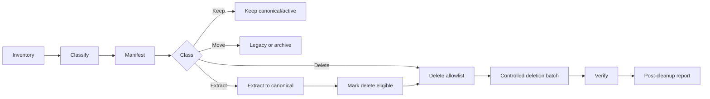
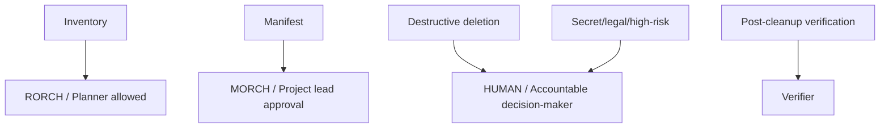

# Work.AI.CLEAN_SKILLS.md — Project Folder, Subfolder and File Cleanup Skill

## 0. Skill identity

**Skill name:** Work.AI.CLEAN  
**Category:** Repository / workspace / project hygiene  
**Scope:** Transversal; usable for software projects, business projects, legal files, real estate folders, academic work, finance packs, AI evidence folders and operations workspaces.  
**Primary users:** Humans, AI systems, project managers, technical leads, administrators and auditors.  
**Core output:** A safe, evidence-based cleanup process for folders, subfolders and files.

---

## 1. Plain-language definition for humans

Work.AI.CLEAN defines how to clean a messy project folder without losing useful information.

It answers:

```text
What should stay?
What should move?
What should be extracted?
What can be deleted?
What is unknown and must not be deleted?
What evidence proves cleanup was safe?
```

The skill assumes that messy folders often contain a mix of:

- canonical files;
- useful but disorganized files;
- duplicates;
- obsolete files;
- generated files;
- temporary files;
- logs;
- evidence;
- old versions;
- unknown material.

The goal is to clean without destroying value.

---

## 2. Technical definition for AI systems

For an AI system, cleanup is a controlled classification and mutation workflow:

```text
inventory
-> classify
-> manifest
-> quarantine / legacy
-> extract useful data
-> allowlist deletion
-> execute controlled batch
-> verify
-> report
```

The AI must never treat “messy” as “delete.”

---

## 3. Non-negotiable principles

```text
UNKNOWN != DELETE
EVIDENCE_BEFORE_CLAIM
MANIFEST_BEFORE_MUTATION
ALLOWLIST_BEFORE_DELETE
EXTRACT_BEFORE_DELETE
SINGLE_WRITER_PER_CONFLICTING_RESOURCE
BATCH_SMALLER_THAN_RISK
ROLLBACK_OR_RECOVERY_PLAN_REQUIRED
```

---

## 4. When to use this skill

Use Work.AI.CLEAN when:

1. A project root has too many files/folders.
2. There are obsolete artifacts.
3. Generated files clutter the workspace.
4. Multiple versions of documents exist.
5. AI or humans cannot determine what is canonical.
6. The project has untracked files.
7. There are legacy folders that may contain useful data.
8. The team wants to prepare for release, handoff, audit or long-running automation.
9. Cleanup will affect trust, reproducibility or execution safety.

---

## 5. When not to use this skill

Do not run cleanup when:

- there is no backup or version control and the data is high value;
- the user has not authorized mutation;
- legal or compliance hold may apply;
- classification cannot be performed;
- the system cannot distinguish canonical from obsolete;
- credentials/secrets may be exposed and no safe handling plan exists;
- cleanup would interrupt an active production process.

In those cases, perform **read-only inventory only**.

---

## 6. Cleanup roles

| Role | Responsibility |
|---|---|
| HUMAN | Authorizes destructive cleanup and resolves ambiguous business/legal value. |
| MORCH / Project Lead | Sets cleanup policy, scope and priority. |
| RORCH / Orchestrator | Creates manifest, DAG, batches, gates and evidence. |
| SPECIALIST | Reviews or extracts bounded high-risk categories. |
| EXE / Executor | Performs allowed move/delete/extract operations. |
| VERIFIER | Independently verifies evidence and post-cleanup state. |

For non-NightShift projects, map these to equivalent roles:

```text
HUMAN = accountable decision-maker
MORCH = lead coordinator
RORCH = operations planner
EXE = implementer
VERIFIER = reviewer/auditor
```

---

## 7. Cleanup classification taxonomy

Every file/folder must be classified before mutation.

| Class | Meaning | Default action |
|---|---|---|
| KEEP_CANONICAL | Official current source of truth | Keep in place |
| KEEP_ACTIVE | Still used but not canonical | Keep or move to active area |
| MOVE_LEGACY | Possibly useful, not active | Move to legacy/quarantine |
| EXTRACT_TO_CANON | Contains useful data that must be incorporated elsewhere | Extract first |
| ARCHIVE | Keep for history/compliance but not active | Move to archive |
| DELETE_REPRODUCIBLE | Generated and reproducible | Delete after allowlist |
| DELETE_DUPLICATE | True duplicate of a canonical file | Delete after hash/path evidence |
| DELETE_OBSOLETE | Superseded and no longer useful | Delete after allowlist |
| SECRET_REVIEW | May contain credentials/sensitive data | Quarantine/review; do not expose |
| LEGAL_HOLD | Must be preserved for legal/compliance reasons | Preserve |
| UNKNOWN | Insufficient evidence | Do not delete |

---

## 8. Recommended folder structure

Use or adapt this structure:

```text
PROJECT_ROOT/
  00_CANONICAL/
  01_ACTIVE/
  07_EVIDENCE/
  90_LEGACY/
    README.md
    MANIFEST.json
    pending_review/
    extracted/
    obsolete_candidates/
    unknown_hold/
  91_ARCHIVE/
  99_TRASH_STAGED/
```

Notes:

- `90_LEGACY` is temporary, not a permanent dumping ground.
- `91_ARCHIVE` is for retained history/compliance.
- `99_TRASH_STAGED` is optional and should be short-lived.
- Do not create new structure if the project already has a documented standard; adapt to it.

---

## 9. Required cleanup artifacts

Before deletion:

```text
CLEANUP_MANIFEST.md
CLEANUP_INVENTORY.json
DELETE_ALLOWLIST.txt
MOVE_MANIFEST.json
EXTRACTION_REGISTER.md
POST_CLEANUP_REPORT.md
```

For high-risk cleanup, also include:

```text
BACKUP_OR_RECOVERY_PLAN.md
RISK_REGISTER.md
VERIFICATION_REPORT.md
```

---

## 10. Cleanup manifest schema

Minimum manifest fields:

```text
ITEM_ID=
ORIGINAL_PATH=
ITEM_TYPE=file|folder
SIZE=
HASH_IF_FILE=
CLASSIFICATION=
REASON=
CANONICAL_TARGET=
MOVE_TARGET=
EXTRACTION_REQUIRED=true|false
EXTRACTION_TARGET=
DELETE_ELIGIBLE=true|false
DELETE_BATCH=
AUTHORITY_REQUIRED=
RISK_LEVEL=low|medium|high|critical
STATUS=pending|moved|extracted|deleted|held
EVIDENCE=
```

---

## 11. Legacy extraction rule

Legacy is a temporary quarantine for potentially useful material.

```text
LEGACY_RULE:
1. Move candidate to legacy only if it may contain useful information.
2. Assign LEGACY_ID.
3. Record source path and reason.
4. Extract useful data into canonical target.
5. Record extraction evidence.
6. Mark original as EXTRACTED_DELETE_ELIGIBLE.
7. Delete the original legacy source in the approved deletion batch.
```

The phrase “move to legacy” must never mean “forget forever.”

---

## 12. Deletion rule

Deletion is allowed only if:

```text
DELETE_ALLOWED=true when:
- item appears in cleanup manifest;
- classification is DELETE_REPRODUCIBLE, DELETE_DUPLICATE, DELETE_OBSOLETE or EXTRACTED_DELETE_ELIGIBLE;
- item appears in explicit delete allowlist;
- no dependency references it;
- authority requirement is satisfied;
- post-delete verification is planned.
```

Deletion is forbidden if:

```text
classification=UNKNOWN
classification=LEGAL_HOLD
classification=SECRET_REVIEW unresolved
authority not granted
manifest missing
allowlist missing
```

---

## 13. Batch strategy

Use small batches.

Recommended order:

```text
BATCH_001: obvious reproducible junk
BATCH_002: generated logs/temp/cache/build outputs
BATCH_003: true duplicates
BATCH_004: obsolete superseded artifacts
BATCH_005: legacy files after extraction
BATCH_006: structural folder moves
```

High-risk categories require separate batches:

```text
governance
legal
finance
state
human communications
credentials/secrets
source code
evidence
```

---

## 14. Diagram requirement

Cleanup plans must include diagrams.

### 14.1 Cleanup flow



### 14.2 Authority map



---

## 15. Output schema for AI cleanup

```text
TARGET=WORK_AI_CLEAN
PROJECT=
ROOT=
MODE=READ_ONLY_INVENTORY|PLAN_ONLY|MOVE_ONLY|DELETE_BATCH|VERIFY
CURRENT_STATE=
INVENTORY_SUMMARY=
CLASS_COUNTS=
HIGH_RISK_ITEMS=
MANIFEST_PATH=
MOVE_PLAN=
EXTRACTION_PLAN=
DELETE_ALLOWLIST=
AUTHORIZATIONS_REQUIRED=
MUTATION_EXECUTED=
DELETION_EXECUTED=
VERIFICATION=
RISKS=
NEXT=
TERMINAL_CONVERGENCE=
```

---

## 16. Read-only inventory prompt

Use this when mutation is not yet authorized.

```text
TARGET=WORK_AI_CLEAN
ROLE=READ_ONLY_INVENTORY
ROOT=<project root>
MODE=READ_ONLY

Rules:
- Do not modify files.
- Do not delete files.
- Do not move files.
- Do not expose secrets.
- Produce inventory and classification proposal only.

Output:
- counts by type;
- top-level clutter;
- high-risk categories;
- recommended manifest;
- next safe batch.
```

---

## 17. Move-to-legacy prompt

Use only after move authorization.

```text
TARGET=WORK_AI_CLEAN
ROLE=LEGACY_QUARANTINE_EXECUTOR
ROOT=<project root>
MODE=MOVE_ONLY

Rules:
- Move only files listed in MOVE_ALLOWLIST.
- Preserve original path in manifest.
- Assign LEGACY_ID.
- Do not delete.
- Verify moved files exist at target.
- Produce move report.
```

---

## 18. Extract-from-legacy prompt

```text
TARGET=WORK_AI_CLEAN
ROLE=LEGACY_EXTRACTION
ROOT=<project root>
MODE=EXTRACT_TO_CANON

Rules:
- Read one legacy item or one category at a time.
- Extract only useful data.
- Write to declared canonical target.
- Record what was extracted.
- Mark original as EXTRACTED_DELETE_ELIGIBLE only after verification.
```

---

## 19. Delete batch prompt

```text
TARGET=WORK_AI_CLEAN
ROLE=DELETE_BATCH_EXECUTOR
ROOT=<project root>
MODE=DELETE_BATCH

Rules:
- Delete only paths in DELETE_ALLOWLIST.
- Refuse UNKNOWN.
- Refuse unresolved SECRET_REVIEW.
- Refuse LEGAL_HOLD.
- Record before/after status.
- Produce deletion report.
- Stop on unexpected path.
```

---

## 20. Verification checklist

After cleanup:

```text
- manifest updated;
- allowlist consumed or archived;
- no unexpected files deleted;
- canonical files still present;
- extracted data present in target;
- legacy source deleted only if eligible;
- project opens/builds/runs if applicable;
- git status understood;
- evidence written;
- risks updated.
```

---

## 21. Common failure modes

Avoid:

1. Deleting because a file “looks old.”
2. Moving everything to legacy and never extracting.
3. Deleting evidence required for audit.
4. Treating generated logs and canonical reports the same.
5. Deleting source-like files without review.
6. Cleaning without manifest.
7. Cleaning without post-verification.
8. Mixing cleanup with unrelated feature work.
9. Deleting secrets without secure handling.
10. Treating an AI guess as evidence.

---

## 22. Acceptance criteria

Cleanup is accepted only if:

```text
CLEANUP_ACCEPTED=true when:
- inventory exists;
- manifest exists;
- all mutated files were classified;
- all deletions were allowlisted;
- UNKNOWN was not deleted;
- useful legacy data was extracted before deletion;
- post-cleanup verification exists;
- risks and residual unknowns are explicit.
```

---

## 23. Final rule

Cleanup is not “make the folder look clean.” Cleanup is controlled reduction of uncertainty and clutter while preserving value, evidence and recoverability.